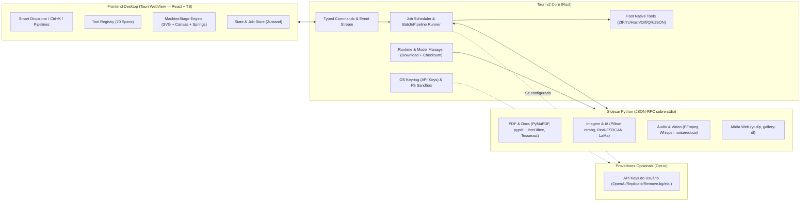

# Universe — Visão de Produto e Arquitetura

## 1. Visão Geral e Tese Criativa

O **Universe** é um aplicativo desktop universal para PC (Linux principal, com suporte cross-platform para Windows e macOS) que reúne **70 ferramentas reais** de conversão, PDF, imagem, download de mídia, vídeo/áudio, utilitários digitais e automação em um único software local, gratuito, sem paywalls e sem dependência de sites cheios de anúncios.

**Tese criativa:** *Uma oficina tátil de precisão industrial (Industrial-Craft) — onde cada operação digital se comporta como uma máquina física silenciosa, responsiva e confiável.* Ao arrastar um arquivo ou colar um link, o usuário não vê um spinner genérico: vê a máquina correspondente receber o insumo, executar o trabalho em sincronia com o progresso real (prensa hidráulica, guilhotina, scanner óptico, carretel de captura, tambor de cofre) e devolver o resultado pronto para uso ou encadeamento.

## 2. Decisões Fechadas no Alinhamento (`/grill-me`)

| Dimensão | Decisão |
| --- | --- |
| **Stack Desktop** | **Tauri v2** (Rust) + **React 19 / TypeScript / Vite** + **Sidecar Python** (worker local de processamento) |
| **Sistema Operacional** | **Linux principal** (`.AppImage` / `.deb`), mantendo compatibilidade cross-platform (**Windows 11** e **macOS**) |
| **Motores e IA** | **Híbrido (Local-first)**: 100% local e gratuito por padrão (baixando binários e modelos sob demanda), com suporte opcional a **API keys** do usuário para IA pesada (upscale, transcrição, remoção de objetos/fundo) |
| **Direção Estética** | **Oficina Tátil / Industrial-Craft** (inspiração Dieter Rams, Teenage Engineering, Apple Hardware) |
| **Temas** | **Modo Claro** (chassi alumínio / papel técnico) + **Modo Escuro** (grafite anodizado) com alternância imediata |
| **Áudio / Sons** | **Sem sons** — feedback 100% visual, tátil e cinético |
| **Fluxos de Produtividade** | **Smart Dropzone Universal**, **Processamento em Lote (Batch)**, **Command Palette (`Ctrl+K`) + Favoritos/Recentes** e **Encadeamento de Ferramentas (Pipelines)** |
| **Estratégia de Entrega** | Arquitetura completa para as 70 ferramentas + implementação em **fases funcionais** (Fase 1: Utilitários 51–60, Imagens 21–30 e PDF 11–20) |

## 3. Arquitetura do Sistema



### 3.1 Responsabilidades por Camada

1. **Frontend (React + TypeScript + Tailwind CSS + Framer Motion / SVG / Canvas)**
   - Renderiza o chassi da oficina, widgets interativos, Smart Dropzone, Command Palette (`Ctrl+K`), fila de lote, editor visual de pipelines e o **`MachineStage`** de cada ferramenta.
   - Nunca bloqueia a main thread: toda computação pesada roda em Rust ou no sidecar Python, emitindo eventos de progresso estruturados (`progress`, `stage`, `metrics`, `eta`, `previewPath`).
2. **Core Nativo (Tauri v2 / Rust)**
   - **Job Scheduler**: controla concorrência configurável (ex: 1 job pesado de IA por vez, até `N` jobs leves de imagem/PDF em paralelo), pausa, cancelamento limpo (`SIGTERM` / kill process group) e limpeza de arquivos temporários.
   - **Execução Nativa Ultrarrápida**: ferramentas puramente de texto/dados/arquivos (ex: formatar JSON, diff, senhas, contador, ZIP/TAR/7z, SRT→VTT) executam direto em Rust com latência < 10 ms.
   - **Runtime & Model Manager**: verifica, baixa sob demanda (com barra de progresso real e validação SHA-256) e atualiza binários/modelos em `~/.local/share/universe/` (Linux) / `%LOCALAPPDATA%\Universe\` (Windows).
   - **Segurança**: API keys opcionais são armazenadas exclusivamente no **Keyring nativo do OS** (Secret Service/KWallet no Linux, Credential Manager no Windows, Keychain no macOS) — nunca em texto plano ou no código.
3. **Sidecar Python (Worker Isolado)**
   - Empacotado ou gerenciado em ambiente virtual isolado (`~/.local/share/universe/venv` via `uv`/Python) para zero conflito com o sistema do usuário.
   - Comunica-se com o Rust via **NDJSON / JSON-RPC sobre `stdin`/`stdout`**, enviando telemetria fina para sincronizar as animações (ex.: `"stage": "pressing"`, `"progress": 0.64`, `"inputBytes": 12400000`, `"currentBytes": 3100000`).

## 4. Fluxos Principais de Produtividade

### 4.1 Smart Dropzone Universal
- Presente na Home e acessível globalmente ao arrastar qualquer arquivo sobre a janela do aplicativo (overlay magnético com borda industrial animada).
- **Detecção automática**:
  - Arquivos únicos ou múltiplos: inspeciona extensão + *magic bytes* (MIME real) e apresenta imediatamente os **cartuchos de ferramentas compatíveis** ordenados por relevância e histórico de uso.
  - URLs coladas (`Ctrl+V` global ou drop de link): identifica domínio (YouTube, Shorts, Instagram, TikTok, Pinterest, X, Facebook, Reddit ou URL genérica para encurtar/QR/HTML→PDF) e abre a bancada correspondente em 1 clique.

### 4.2 Processamento em Lote (Batch)
- Qualquer ferramenta marcada como `supportsBatch: true` aceita múltiplos arquivos ou pastas inteiras.
- **Bandeja de Lote (Batch Tray)**: mostra fila de itens com miniaturas, status individual (`queued`, `running`, `done`, `error`), taxa de compressão/economia agregada e opção de exportar para pasta única ou empacotar resultado em ZIP.
- Falha em um arquivo do lote nunca derruba os demais; o usuário pode clicar em **"Tentar novamente falhos"**.

### 4.3 Command Palette (`Ctrl+K`) + Favoritos/Recentes
- Busca instantânea com fuzzy matching em português e inglês (ex: digitar `"prensar"`, `"comprimir pdf"`, `"yt"`, `"fundo"`, `"qr"`).
- Suporta atalhos diretos de ação (`Enter` abre ferramenta; `Ctrl+Enter` executa na última configuração; `Ctrl+D` fixa nos Favoritos).
- A Home exibe **Favoritos fixados**, **Recentes (últimas 6 ferramentas)** e **Últimos outputs** (com botão "Abrir pasta" e "Encadear para outra ferramenta").

### 4.4 Encadeamento de Ferramentas (Pipelines)
- Permite montar cadeias visuais de ferramentas onde a saída de uma etapa alimenta automaticamente a entrada da próxima.
- Exemplos prontos (presets editáveis):
  - *YouTube → Extrair Áudio → Remover Ruído → Transcrever Texto*
  - *Imagens HEIC → Converter JPG → Remover Metadados → Redimensionar → Comprimir → Criar ZIP*
  - *PDF Escaneado → OCR → Extrair Texto / Comprimir PDF*
- Validação estática de compatibilidade de tipos entre nós (`outputMime[] ∩ next.inputMime[] ≠ ∅`) antes de rodar.
- Pipelines podem ser salvos como **Receitas personalizadas** e disparados via `Ctrl+K` ou Smart Dropzone.

## 5. Estrutura do Repositório

```text
universe/
├── docs/
│   ├── 01-product-and-architecture.md
│   ├── 02-design-system-and-motion.md
│   ├── 03-tools-catalog-and-animations.md
│   └── 04-roadmap-and-acceptance.md
├── apps/
│   └── desktop/
│       ├── src/
│       │   ├── app/                  # Shell, roteamento, temas, Ctrl+K
│       │   ├── design-system/        # Tokens CSS, componentes táteis
│       │   ├── machines/             # MachineStage engine + 70 máquinas animadas
│       │   ├── features/
│       │   │   ├── home/             # Smart Dropzone, favoritos, recentes
│       │   │   ├── workspace/        # Bancada da ferramenta ativa + inspetor
│       │   │   ├── batch/            # Bandeja e fila de lote
│       │   │   ├── pipelines/        # Editor visual e executor de cadeias
│       │   │   └── settings/         # Motores locais, modelos IA, API keys
│       │   ├── registry/             # Definição tipada das 70 ferramentas
│       │   └── lib/                  # IPC Tauri, detecção MIME/URL, stores
│       └── src-tauri/
│           ├── src/
│           │   ├── commands/         # Comandos IPC expostos ao frontend
│           │   ├── scheduler/        # Fila de jobs, batch, pipelines
│           │   ├── native_tools/     # Ferramentas ultrarrápidas em Rust
│           │   ├── sidecar/          # Ponte JSON-RPC com worker Python
│           │   └── runtime/          # Download/verificação de binários e modelos
│           └── tauri.conf.json
├── workers/
│   └── python/
│       ├── universe_worker/
│       │   ├── protocol.py           # Servidor NDJSON-RPC + eventos de progresso
│       │   ├── engines/              # pdf, docs, images, ai, media, download, ocr
│       │   └── providers/            # Adaptadores opcionais de API externa
│       └── pyproject.toml
└── package.json
```

## 6. Política de Dependências, Modelos e Uso Responsável

- **Instalação limpa**: o instalador inicial do Universe permanece leve (~20–35 MB). Motores pesados (`ffmpeg`, `yt-dlp`, `gallery-dl`, `tesseract`, modelos ONNX de `rembg`, `Real-ESRGAN`, `LaMa`, `faster-whisper`) são baixados **sob demanda** na primeira vez que o usuário abre uma ferramenta que depende deles, com tamanho exibido claramente antes do download e botão de gerenciamento de espaço em *Configurações → Motores*.
- **Office (Word/Excel/PowerPoint ↔ PDF)**: detecta LibreOffice já instalado no sistema (`/usr/bin/soffice` no Linux) ou orienta/baixa runtime compatível; para PDF → Word/Excel/PPT usa pipelines Python (`pdf2docx`, `pdfplumber`/`openpyxl`, `python-pptx`).
- **Downloads de mídia (#31–#40)**: exibem aviso discreto e claro de que downloads estão sujeitos às permissões, aos direitos autorais e aos termos de cada plataforma. O usuário pode atualizar o `yt-dlp` com 1 clique dentro do app.
- **Privacidade**: zero telemetria obrigatória; arquivos processados localmente nunca saem da máquina do usuário, exceto quando o usuário ativa explicitamente um provedor de API externo ou usa o encurtador de links (#53).
